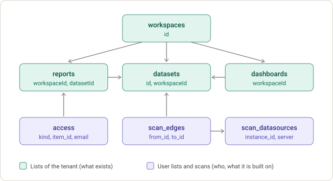

# Data lake

The data lake is a folder (or an S3 prefix) where pbi_cli keeps what it fetched from the
Power BI REST API, exactly as the API returned it. The commands that read the API write to
it, [`pbi sync`](sync.md) fills it on a schedule, `pbi lake` browses it, and other tools can
read it: it is plain JSON in Hive-style folders.

## Using it from the command line

### Turn it on

The lake is the `lake` folder inside the cache folder. Set the cache folder once:

```bash
pbi config set-cache-folder ~/PowerBI/cache           # the lake is ~/PowerBI/cache/lake
pbi config set-cache-folder s3://my-bucket/powerbi    # or a prefix in S3
```

Without a cache folder nothing is stored and the commands work as they always did.
`pbi config disable-cache` stops the commands from using the lake without forgetting the
folder, and `pbi config enable-cache` switches it back on. Browsing with `pbi lake` works
either way.

### What the commands store

| Command | What is stored | `--use-cache`, `--cache-only` |
| --- | --- | --- |
| `pbi workspaces list` | `admin.groups` | yes |
| `pbi users user-access` | `admin.users.artifact_access` | yes |
| `pbi apps list` | `user.apps`, or `admin.apps` with `--role admin` | yes |
| `pbi reports list` | `user.group_reports` | no: always asks the API |
| `pbi reports pages` | `user.report_pages` (and `user.group_reports` without `--report-id`) | no: always asks the API |
| `pbi workspaces scan batch` | `admin.scan.result`, one per batch of 100 workspaces | no: always scans |
| [`pbi sync run`](sync.md) | what its targets need: lists, audit events, scans, fan-outs | it skips what is fresh (`--max-age`, `--force`) |

The endpoint ids are explained under [Endpoints and quotas](#endpoints-and-quotas). The
other commands that call the API (`workspaces scan initiate|status|result|get`,
`workspaces report-users`, `reports users`, `reports export`, `apps app`, `apps augment`
and `export`) do not use the lake yet.

Every call asks the API, waits when a [quota](#throttling) is used up, and adds a new
version to the lake: nothing is overwritten. The commands that print a table say which
version they stored (`Saved to the data lake (version: 20260930T214332941747Z)`); the
commands that print JSON, such as `pbi reports list`, print only the JSON so that it can be
piped, and store silently.

### Reuse what is stored

```bash
# A stored answer to this very request, of any age; the API only if there is none
pbi workspaces list --use-cache

# Only a stored answer: fails if there is none, never calls the API
pbi workspaces list --cache-only
```

- A stored answer belongs to a *request*: the endpoint, its parameters (`--top`,
  `--expand`, `--odata-filter`, the user id, the role) and the tenant. `--use-cache` with
  another `--top` or `--expand` does not return the answer to the first one: it asks the
  API. The order of the `--expand` values does not matter. (The earlier
  [cache](cache.md) kept one entry per command, so it could answer with data that had been
  fetched with other options, or by another tenant.)
- With `--use-cache` and `--cache-only` together, `--cache-only` wins.
- The commands read your stored token even for `--cache-only`: its tenant tells which data
  is yours. An expired token is fine, as nothing is sent.
- Without a lake (no cache folder, or caching disabled) `--cache-only` stops and says how
  to set one up; `--use-cache` just asks the API.
- A lake that cannot be read (a damaged file, S3 not reachable) does not stop `--use-cache`:
  the command warns and asks the API, which stores a fresh answer. `--cache-only` has no API
  to fall back on, so it stops and says why.

### Look into the lake: `pbi lake`

`pbi lake` reads the lake only: it needs no token and no network, so it works offline and
with an expired token.

`pbi lake ls` lists what is stored, one line per request (an endpoint with one set of
parameters), with its `REF`: the name of its `params=` folder. `--all-versions` lists
every stored version instead of the newest of each request.

```text
$ pbi lake ls
Data lake: ~/PowerBI/cache/lake

Tenant: 0b6e7f5a-3c1d-4f7e-9a52-7d3c1e8b2f40
ENDPOINT              REF           FETCHED (UTC)     AGE     ROWS  SIZE   VERSIONS  PARAMETERS
admin.activityevents  events        2026-09-30 21:56  0 s     1     -      1 day(s)  newest day 2026-09-28 (sealed)
admin.groups          60177fd656f3  2026-09-30 21:44  12 min  4     143 B  2         $expand=dashboards,dataflows,datasets,reports,users,workbooks $top=1000
admin.groups          9a414e1d2726  2026-09-30 18:56  3 h     1     44 B   1         $top=50
user.apps             44136fa355b3  2026-09-30 20:56  1 h     1     42 B   1         -

$ pbi lake ls -e admin.groups --all-versions
Data lake: ~/PowerBI/cache/lake

Tenant: 0b6e7f5a-3c1d-4f7e-9a52-7d3c1e8b2f40
ENDPOINT      REF           VERSION                 FETCHED (UTC)     AGE     ROWS  SIZE   PARAMETERS
admin.groups  60177fd656f3  20260930T214424436365Z  2026-09-30 21:44  12 min  4     143 B  $expand=dashboards,dataflows,datasets,reports,users,workbooks $top=1000
admin.groups  60177fd656f3  20260928T215624436365Z  2026-09-28 21:56  2 d     3     110 B  $expand=dashboards,dataflows,datasets,reports,users,workbooks $top=1000
admin.groups  9a414e1d2726  20260930T185624436365Z  2026-09-30 18:56  3 h     1     44 B   $top=50
```

`pbi lake show ENDPOINT` prints a stored response as JSON. When an endpoint was fetched
with several sets of parameters, say which one with `-p KEY=VALUE` (as shown under
`PARAMETERS`; the order of the values of `$expand` does not matter) or with `--ref`.
`--version` picks an older version and `--manifest` prints what was asked, when, by which
profile and a checksum, instead of the data.

```text
$ pbi lake show admin.groups
Error: 2 stored requests of admin.groups match; choose one with -p KEY=VALUE or --ref:
  60177fd656f3  $expand=dashboards,dataflows,datasets,reports,users,workbooks $top=1000
  9a414e1d2726  $top=50

$ pbi lake show admin.groups -p '$top=50'
{
  "value": [
    {
      "id": "g0",
      "name": "Workspace 0"
    }
  ]
}

$ pbi lake show admin.groups -p '$top=50' --manifest
{
  "schema": 1,
  "kind": "snapshot",
  "endpoint": "admin.groups",
  "tenant": "0b6e7f5a-3c1d-4f7e-9a52-7d3c1e8b2f40",
  "profile": "admin-nlm",
  "fetched_at": "2026-09-30T18:56:24.436365+00:00",
  "request": {
    "method": "GET",
    "path": "/admin/groups",
    "params": {
      "$top": "50"
    }
  },
  "params": {
    "$top": "50"
  },
  "params_hash": "9a414e1d2726",
  "status": 200,
  "pages": 1,
  "rows": 1,
  "data_file": "data.json",
  "bytes": 44,
  "sha256": "ecf45bef6dda1dbfac0201cd0cd4596ad7481b9ab4ab982b27cbdf0072500695",
  "cli_version": "0.4.0"
}
```

Event logs are kept per UTC day: choose the day with `--day`. The events are printed one
per line.

```text
$ pbi lake show admin.activityevents --day 2026-09-28
{"Id": "e1", "Activity": "ViewReport", "UserId": "alice@example.com"}
```

The lake grows, because every call adds a version. `pbi lake prune` deletes old versions
and keeps the newest of each request (`--keep N` keeps more; `--endpoint` and `--tenant`
narrow it down). It asks first, or pass `--yes`. Event logs are never pruned.

```text
$ pbi lake prune --yes
✓ Deleted 1 old version(s), kept the newest 1 of each request
```

`pbi cache clear` never touches the lake; see [Cache (legacy)](cache.md).

### Who has access to everything: `pbi lake users`

`pbi lake users KIND` lists the people of every item of a kind at once (`report`,
`dataset`, `dashboard`, `dataflow`, `app` or `workspace`): one row for each person and item,
from what the lake holds, with no token and no network.

```text
$ pbi lake users report
Kind    Item          Workspace    Name  E-mail or id          Access
Report  Sales         Finance      Ann   ann@example.com       Owner
Report  Sales         Finance      Bob   bob@example.com       Viewer
Report  Stock         Logistics    Ann   ann@example.com       Owner

3 row(s): 2 different people, 2 of 2 report(s) with users.
```

`-o report-users.xlsx` saves it instead (the ending says the format: `.csv`, `.xlsx`,
`.json`, `.md` or `.tsv`, or choose with `-f`), and `-w Finance` narrows it to the items of a
workspace, by name or id (repeat it for more). A file has more columns than the terminal
shows: the ids of the item and of its workspace, the type of the person (user, group) and
where the lake has them from. Items whose users the lake does not hold are named after the
table, so a gap is never mistaken for an item nobody can open. The users come from
`pbi sync run report-users`, `app-users` or a scan with `--get-artifact-users` (see
[Sync](sync.md)).

### What one person has access to: `pbi lake access`

The other way round: `pbi lake access ann@example.com` looks through the users of every item
the lake holds and lists the ones where that person is, whether a workspace, a report, a
dataset, a dashboard, a dataflow or an app. The person is found by e-mail address or name,
ignoring case; `--partial` takes a part of one (`--partial @contractor.com` for everybody of a
domain, which also shows who they are).

```text
$ pbi lake access ann@example.com
Kind       Item      Workspace  Access  Source
Workspace  Finance   Finance    Admin   admin.groups
Report     Sales     Finance    Owner   admin.reports.users
Report     Stock     Logistics  Viewer  admin.reports.users

3 item(s) in 2 workspace(s) for 'ann@example.com'.
```

`-k report -k dashboard` limits it to some kinds, `-w Finance` to the items of a workspace,
and `-o ann.xlsx` saves it (`.csv`, `.xlsx`, `.json`, `.md`, `.tsv`). It sends nothing to
Power BI, so it is only as complete as the lake: the items whose users the lake does not hold
are counted and named under the table, because they might list the person too. It answers
from [the access table](#the-access-table), so it is quick once that is worked out. Access through
a group shows as the group, since the lake does not hold who is in it. For Power BI's own
answer, with an admin account, use `pbi users user-access -u <user id>`; it costs one request
of the quota of 200 an hour.

### Filling the gaps: `--fetch`

Who can open what is in the lake only for the items that were synced with
`pbi sync run report-users`, `app-users` and the like (or a scan with `--get-artifact-users`).
`pbi lake users` and `pbi lake access` name the items they could not look into. Add `--fetch`
and they fetch those users first, as the sync does:

```text
$ pbi lake access ann@example.com -k report --fetch
To fetch the users that the lake lacks:

Tenant: 72f988bf-...

TARGET        ... REQUESTS
report-users  ... 212
...
Fetch them now? [y/N]: y
  [21/212] admin.reports.users ...
```

It shows what it costs against the quotas (the users of a report are 200 requests an hour)
and asks (`--yes` skips that). What the lake holds fresh is not fetched again, so only the
gaps cost anything, and `-w Finance` (or `-w ID`) fetches only for the items of that
workspace. Without `-k`, `lake access` fetches every kind, so narrow it down if the lake is
big. `--fetch` needs an admin account (`pbi auth -t <token> -g admin`) and writes into the lake
of your cache folder; a lake given with `--lake` is only read. A run that a quota or an expired
token stops keeps what it got: run the command again.

### Back up a lake before writing into it

In a local lake every file is written to a temporary name and then moved over the old one,
so a file is never seen half written. S3 (and the other clouds) has no such move: a sync, a
prune or a publish that stops half way, because the connection dropped or the laptop went to
sleep, leaves some objects new and some old. A copy taken just before is the way back.

`pbi lake backup` copies a whole lake, by default next to it as
`<lake>-backup-<UTC time>`, or to `--to <empty folder or URL>`. The commands that write into
a lake take the copy themselves with `--backup` (or `--backup-to PLACE`), before the first
write:

| Command | What is copied |
| --- | --- |
| `pbi sync run --backup` | the work lake |
| `pbi lake prune --backup` | the work lake |
| `pbi lake publish DESTINATION --backup` | the destination, when an earlier publish is there |

```text
$ pbi sync run --backup
Backing up s3://my-bucket/pbi-lake before the sync ...
✓ Backed up 4210 file(s) to s3://my-bucket/pbi-lake-backup-20261030T224000Z
```

Without the flag, these commands give a one-line tip when the lake is in a cloud. A backup
that cannot be made (the place holds something already, the bucket refuses) stops the
command before anything is written. Between two places of the same cloud the objects are
copied by the cloud, not through your machine; the bucket needs room for a second copy.

The copy has the layout of a lake: `pbi tui --lake <copy>` opens it (read only). Its
`backup.json` is written last and says what was copied and when; a copy without it stopped
before it was complete. Backups are never deleted by pbi: remove the old ones yourself.

To go back, `pbi lake restore BACKUP` puts a backup back over the lake of the cache folder:

```text
$ pbi lake restore s3://my-bucket/pbi-lake-backup-20261030T224000Z
Backup: s3://my-bucket/pbi-lake-backup-20261030T224000Z, made 2026-10-30 22:40 UTC
  of:   s3://my-bucket/pbi-lake
Lake:   s3://my-bucket/pbi-lake

To restore: copy 4210 file(s) (310.2 MB), delete 12 file(s) that the backup does not have.

Replace the lake s3://my-bucket/pbi-lake with the backup? [y/N]: y
✓ The lake as it was is kept in s3://my-bucket/pbi-lake-before-restore-20261031T071500Z
✓ Restored: 4210 file(s) copied (310.2 MB), 12 deleted
```

It shows what it would copy and delete and asks first (`--yes` skips). The lake becomes what
the backup holds: files of the backup are copied back and files that it does not have are
deleted (`--keep-extra` keeps them). All files are copied before any is deleted, so a restore
that stops half way has lost nothing; run it again. Unless you say `--no-safety-copy`, the lake
as it is now is copied first (`<lake>-before-restore-<time>`), so that a restore can be undone
too. A backup without its `backup.json` stopped before it was complete and is refused
(`--allow-incomplete` overrides that). Close the terminal UI and stop any sync before you
restore: nothing should write to the lake while it is replaced. A published lake is protected
and is not restored over. The [terminal UI](tui.md#who-has-access-a-report-as-a-file-a-copy-of-the-lake) has
*Back up the lake* in its palette; a sync run from it takes no backup of its own.

Every one of these commands (and `pbi sync status` and `pbi tui`) can look at another lake
than the one of your cache folder, such as one that a colleague shared, with
`--lake <folder or s3://bucket/folder>`. A lake opened that way is only read, and `prune`
refuses it. `pbi lake publish` makes a copy of your lake for others to open. See
[Sharing a lake](sharing.md).

To look around instead of listing, open the [terminal UI](tui.md) (`pbi tui`): the
workspaces of the tenant, what is in them, who can open it, how it is connected, and how
fresh each part is, all read from the lake.

## Why

- The admin APIs allow few requests. The workspace list, for example, allows 50 per hour
  for the whole tenant, so asking again for something you already have is expensive.
- Some data disappears from the API: audit activity events only go back 28 days, and
  the list of modified workspaces only 30 days. A lake is the only way to keep a history.
- What was fetched is useful on its own: to browse offline, to compare two days, or as
  input for other tools.

## Layout

```text
<root>/
  tenant=<tenant id>/
    endpoint=admin_groups/
      params=ab8d3b0ee9eb/                  one folder per set of request parameters
        dt=2026-09-30/
          v=20260930T204900123456Z/         one folder per fetch
            data.json                       the response, all pages merged
            manifest.json                   what was asked, when, by whom, a checksum
    endpoint=admin_activityevents/
      dt=2026-09-29/                        events are kept per UTC day
        part-0000.jsonl                     one JSON object per line
        part-0001.jsonl
        manifest.json                       parts, row count, resume cursor, sealed?
    endpoint=admin_scan_result/
      params=5904788ae261/                  one folder per scan: its workspaces and options
        dt=2026-09-30/v=.../                a scan is stored like a snapshot (a "job")
    _state/
      sync.json                             what `pbi sync` remembers between runs
    _tables/
      access.csv                            who has access to what, worked out from the above
      access-gaps.csv                       the items whose users the lake does not hold
      access.json                           when it was worked out
      STALE                                 only when a snapshot is newer than the table
  _layers/<shared lake>/tenant=<tenant id>/
    _tables/                                the access table of a shared lake with this one on
                                            top (`--with-work-lake`), and what it was built from
  publish.json                              only in a published lake: who, when, what was left out
```

The folder names are Hive-style partitions, so tools such as Athena, DuckDB and Spark can
read them. The tenant comes from the token (see [authentication](auth.md)); a token that
does not name a tenant is filed under its profile instead (`tenant=profile-<name>`), never
under a guess. `params=<hash>` is the first 12 hex digits of the SHA-256 of the canonical
request parameters; the manifest spells them out.

A request is identified by its endpoint and its *canonical* parameters: booleans are lower
case and lists of unordered values, such as `$expand`, are sorted. Asking for
`$expand=users,reports` and `$expand=reports, users` is the same request; asking for a
different `$expand`, or as another tenant, never returns somebody else's answer.

The manifest is written last. A version folder without one is an interrupted write and is
ignored.

A lake with a `publish.json` at its root has been [published](sharing.md#publish-a-lake). It
is protected: only `pbi lake publish` writes to it.

### The access table

Who has access to an item is in many places: the answer of the item's own request
(`admin.reports.users` and the like, one folder per item), the users of a workspace in the list
of workspaces, and the users of every item in the scans. Reading all of them takes seconds on a
lake of thousands of items, and minutes when the files are read for the first time (on Windows
the virus scanner looks at each one). So `pbi lake access`, `pbi lake users` and the terminal
UI read them **once** into one table, `_tables/access.csv`, and answer from that.

- **When it is worked out:** `pbi sync run` does it at its end when it stored anything
  (`Updated who has access to what in the lake: … row(s)`); otherwise the first question after
  the lake changed does, and says so (`Working out who has access to what …`).
- **When it is stale:** every snapshot written marks it so (`_tables/STALE`), so a table is
  never older than the lake it answers from; it is worked out again, whole, the next time.
- **What it holds:** one row per person and item, with the same columns as `pbi lake users -o`
  (kind, item, workspace, name, e-mail, access, type, source), in UTF-8. Being a plain CSV,
  it opens in a spreadsheet, DuckDB and pandas as it is. The `source` says whether a row came
  from the item's own request, the list of workspaces, or a `scan`.
- **A lake that is only read** (`--lake`, a published lake) uses a table that is there and
  otherwise works one out in memory each time, since it cannot keep it. `pbi lake publish`
  publishes the table with the lake, unless the users or the scans are left out.
- **A shared lake with your work lake on top** (`--with-work-lake`, see
  [Look further with your own account](sharing.md#look-further-with-your-own-account)) has a
  table of both, kept in your work lake under `_layers/`. It is worked out again when your work
  lake changes or the shared lake is published again.

It holds the names and e-mail addresses of everybody with access: keep it as private as the
rest of the lake.

### The manifest of a snapshot

| Field | Meaning |
| --- | --- |
| `schema` | Version of this layout (currently 1). |
| `kind` | `snapshot`, or `job` for the result of an asynchronous job. |
| `endpoint` | The endpoint id (see the table below). |
| `tenant`, `profile` | The tenant, and the name of the profile used. The token is never stored. |
| `fetched_at` | When the response was received, in UTC. |
| `request` | Method, path and canonical parameters that were sent, and a hash of the body. Never headers. |
| `params`, `params_hash` | The canonical parameters and the hash that names the `params=` folder. |
| `status` | The HTTP status of the answer. |
| `pages` | How many API pages were merged into `data.json`. |
| `rows` | How many rows the response holds, when it is a list. |
| `data_file`, `bytes`, `sha256` | The data file, its size and its SHA-256. |
| `cli_version` | The pbi_cli version that wrote it. |

The manifest of a day of events has `kind: events`, the `day`, the `parts`, the number of
`rows`, the `id_field`, a resume `cursor`, when it was last written (`updated_at`) and
whether the day is `sealed` (complete).

The manifest of a scan has `kind: job`. `params` holds the options of the scan and `batch`,
which names its set of workspaces; `workspace_ids` lists them, and `scan_id` and
`started_at` tell which scan of the API it is. `rows` is the number of workspaces.

## Snapshots, event logs and jobs

- A **snapshot** is one response. Every fetch adds a version; nothing is overwritten.
  Old versions can be pruned, keeping the newest of each request.
- An **event log** is append-only: the events of one UTC day, deduplicated by their `Id`, so
  fetching the same day twice adds only what is new. A day is sealed once it is complete.
- A **job** is a scan: start it, poll its status, fetch its result. The result is stored
  like a snapshot, one request per set of workspaces and options, so scanning the same
  workspaces again adds a version. See [Sync](sync.md#scans).

## The data model

The lake is **not** a database with a schema of its own. It keeps what Power BI answered, as
JSON, one folder per request (see [Layout](#layout)); `pbi_cli` adds only a manifest to each.
How the pieces belong together is worked out when they are read, by Power BI's own ids.

| What | Where it is | How it joins |
| --- | --- | --- |
| Workspaces | `admin.groups` (or `user.groups` per account) | `id` |
| Reports, datasets, dashboards, dataflows | the lists of the tenant, else one list per workspace (`user.group_*`) | the row's `workspaceId` is a workspace's `id`; a report's `datasetId` is a dataset's `id` |
| Inside a workspace | `admin.scan.result`, one scan per set of workspaces and options; the newest scan that *returned* a workspace is the one used | `workspaces[].id`, with its reports, datasets, tables, users, data sources |
| Lineage | the scan, with `--lineage` | `upstreamDatasets[].targetDatasetId`, `upstreamDataflows[].targetDataflowId`, a dashboard tile's `reportId` and `datasetId`; `datasourceUsages[].datasourceInstanceId` is a data source's `datasourceId` |
| People | one answer per item (`admin.reports.users` with `reportId`, `admin.apps.users` with `appId`, ...), else the `users` of the item in its scan | the item's id, which the request's parameters name |
| Audit events | one file set per UTC day | `Id` (events are deduplicated by it) |
| Freshness | `fetched_at` in the manifest against the lifetime of the operation | plus `_state/sync.json`: runs, units that failed, scans started |

Nothing is normalized and no key is checked, so a lake that was synced only in part still
works, and says what is missing. The people inside a *group* are not in the lake (Power BI
lists the group, Microsoft Entra lists its members): access through a group shows as the
group.

### Query it with SQL: `pbi lake duckdb`

`pbi lake duckdb` loads the newest answer of every request into a
[DuckDB](https://duckdb.org) database (`pip install "pbi-cli[duckdb]"`). The tables carry the
ids above, so the joins are the ones in this picture:



| Table | One row for | Made from |
| --- | --- | --- |
| `workspaces`, `reports`, `datasets`, `dashboards`, `dataflows`, `apps`, `capacities` | each item of the newest complete list; the columns are Power BI's | the lists of the tenant |
| `access` | each person with access to an item: `kind`, `item_id`, `workspace_id`, `name`, `email`, `access`, `type`, `source` | the user operations and the scans (`source` says which) |
| `scan_items` | each report, dataset, dashboard or dataflow a scan found, with its `workspace_id` and `dataset_id` | the newest scan of each workspace |
| `scan_edges` | each lineage link: `from_kind`, `from_id`, `to_kind`, `to_id`, `relation` | the scans |
| `scan_datasources` | each data source: `instance_id`, `type`, `server`, `database`, `path`, `url` | the scans |
| `scan_tables`, `scan_columns`, `scan_measures` | each table, column (with its DAX) and measure of a dataset | the scans, with the schema option |
| `events` | each audit event, with its `day` | the event logs |
| `requests` | each request the lake holds: endpoint, parameters, `fetched_at`, path | the manifests |
| `report_overview` (a view) | each report with its workspace and dataset names | `reports`, `workspaces`, `datasets` |

```bash
pbi lake duckdb                      # makes pbi-lake.duckdb
duckdb pbi-lake.duckdb
```

```sql
-- Who can open a report that reads from the server sql.example?
select distinct r.report, a.email
from scan_datasources s
join scan_edges e on e.to_id = s.instance_id and e.to_kind = 'datasource'
join scan_edges b on b.to_id = e.from_id and b.from_kind = 'report'
join report_overview r on r.report_id = b.from_id
join access a on a.item_id = r.report_id and a.kind = 'report'
where s.server = 'sql.example';

-- Reports per workspace, and how many people can open them
select workspace, count(distinct report_id) reports, count(distinct email) people
from report_overview r left join access a on a.item_id = r.report_id
group by workspace order by reports desc;
```

The database is a copy: load again after a sync. The lake must be in a folder (copy an S3 lake
down first, for example with `aws s3 sync`). A table is made only when the lake holds the
data for it, and a row of `access` from a scan exists only for a scan made with
`--get-artifact-users`. From Python: [`pbi_cli.core.lakesql`](references/core/lakesql.md).

## Freshness

A stored snapshot is used when it is younger than the `max_age` you ask for; the default is
the `ttl` of the endpoint (24 hours for the admin inventories, 1 hour for what a user can
see). Three modes change that: `refresh` ignores the lake and fetches (the answer is still
stored), `offline` never calls the API and answers from the lake whatever the age, and
`max_age=timedelta(0)` always fetches. A fresh snapshot is served even when the token has
since expired.

The commands do not use the `ttl`: they ask the API unless you pass `--use-cache` (a
stored answer of any age) or `--cache-only` (`offline`). The `ttl` applies to
`client.fetch` calls that pass no `max_age`, as in the Python example below.

## Endpoints and quotas

These are the operations pbi_cli may call. Only reads are listed, plus the scanner API
whose start request is a `POST` that only asks for metadata. Operations that change things
(refresh, delete, add user, ...) and operations that return business data (`Execute
Queries`) are left out on purpose.

The quotas are copied from the documentation page of each operation (checked on
2026-09-30). A dash means the page states no quota; those endpoints are not throttled
locally and rely on the `429` answer of the API.

| Endpoint | Operation | Needs | Quota | Stored as |
| --- | --- | --- | --- | --- |
| `admin.groups` | [Workspaces of the tenant](https://learn.microsoft.com/en-us/rest/api/power-bi/admin/groups-get-groups-as-admin) | admin | 50/h, 15/min | snapshot |
| `admin.apps` | [Apps of the tenant](https://learn.microsoft.com/en-us/rest/api/power-bi/admin/apps-get-apps-as-admin) | admin | 200/h | snapshot |
| `admin.reports` | [Reports of the tenant](https://learn.microsoft.com/en-us/rest/api/power-bi/admin/reports-get-reports-as-admin) | admin | 50/h, 5/min | snapshot |
| `admin.datasets` | [Datasets of the tenant](https://learn.microsoft.com/en-us/rest/api/power-bi/admin/datasets-get-datasets-as-admin) | admin | 50/h, 5/min | snapshot |
| `admin.dashboards` | [Dashboards of the tenant](https://learn.microsoft.com/en-us/rest/api/power-bi/admin/dashboards-get-dashboards-as-admin) | admin | 50/h, 5/min | snapshot |
| `admin.dataflows` | [Dataflows of the tenant](https://learn.microsoft.com/en-us/rest/api/power-bi/admin/dataflows-get-dataflows-as-admin) | admin | 200/h | snapshot |
| `admin.capacities` | [Capacities of the tenant](https://learn.microsoft.com/en-us/rest/api/power-bi/admin/get-capacities-as-admin) | admin | 200/h | snapshot |
| `admin.users.artifact_access` | [Items a user has access to](https://learn.microsoft.com/en-us/rest/api/power-bi/admin/users-get-user-artifact-access-as-admin) | admin | 200/h | snapshot |
| `admin.reports.users` | [Users of a report](https://learn.microsoft.com/en-us/rest/api/power-bi/admin/reports-get-report-users-as-admin) | admin | 200/h | snapshot |
| `admin.datasets.datasources` | [Data sources of a dataset](https://learn.microsoft.com/en-us/rest/api/power-bi/admin/datasets-get-datasources-as-admin) | admin | 300/h | snapshot |
| `admin.groups.users` | [Users of a workspace](https://learn.microsoft.com/en-us/rest/api/power-bi/admin/groups-get-group-users-as-admin) | admin | 200/h | snapshot |
| `admin.datasets.users` | [Users of a dataset](https://learn.microsoft.com/en-us/rest/api/power-bi/admin/datasets-get-dataset-users-as-admin) | admin | 200/h | snapshot |
| `admin.dashboards.users` | [Users of a dashboard](https://learn.microsoft.com/en-us/rest/api/power-bi/admin/dashboards-get-dashboard-users-as-admin) | admin | 200/h | snapshot |
| `admin.dataflows.users` | [Users of a dataflow](https://learn.microsoft.com/en-us/rest/api/power-bi/admin/dataflows-get-dataflow-users-as-admin) | admin | 200/h | snapshot |
| `admin.apps.users` | [Users of an app](https://learn.microsoft.com/en-us/rest/api/power-bi/admin/apps-get-app-users-as-admin) | admin | 200/h | snapshot |
| `admin.dataflows.datasources` | [Data sources of a dataflow](https://learn.microsoft.com/en-us/rest/api/power-bi/admin/dataflows-get-dataflow-datasources-as-admin) | admin | – | snapshot |
| `admin.refreshables` | [How the datasets of the tenant refresh (a summary of each)](https://learn.microsoft.com/en-us/rest/api/power-bi/admin/get-refreshables) | admin | 200/h | snapshot |
| `admin.workspaces.modified` | [IDs of the workspaces modified since a time](https://learn.microsoft.com/en-us/rest/api/power-bi/admin/workspace-info-get-modified-workspaces) | admin | 30/h | snapshot |
| `admin.activityevents` | [Audit activity events of one UTC day](https://learn.microsoft.com/en-us/rest/api/power-bi/admin/get-activity-events) | admin | 200/h | events |
| `admin.scan.start` | [Start a metadata scan of up to 100 workspaces](https://learn.microsoft.com/en-us/rest/api/power-bi/admin/workspace-info-post-workspace-info) | admin | 500/h, 16 concurrent | job |
| `admin.scan.status` | [Status of a scan](https://learn.microsoft.com/en-us/rest/api/power-bi/admin/workspace-info-get-scan-status) | admin | 10000/h | job |
| `admin.scan.result` | [Result of a finished scan](https://learn.microsoft.com/en-us/rest/api/power-bi/admin/workspace-info-get-scan-result) | admin | 500/h | job |
| `user.groups` | [Workspaces the user has access to](https://learn.microsoft.com/en-us/rest/api/power-bi/groups/get-groups) | user | – | snapshot |
| `user.apps` | [Apps installed by the user](https://learn.microsoft.com/en-us/rest/api/power-bi/apps/get-apps) | user | – | snapshot |
| `user.group_reports` | [Reports of a workspace](https://learn.microsoft.com/en-us/rest/api/power-bi/reports/get-reports-in-group) | user | – | snapshot |
| `user.group_datasets` | [Datasets of a workspace](https://learn.microsoft.com/en-us/rest/api/power-bi/datasets/get-datasets-in-group) | user | – | snapshot |
| `user.group_dashboards` | [Dashboards of a workspace](https://learn.microsoft.com/en-us/rest/api/power-bi/dashboards/get-dashboards-in-group) | user | – | snapshot |
| `user.group_dataflows` | [Dataflows of a workspace](https://learn.microsoft.com/en-us/rest/api/power-bi/dataflows/get-dataflows) | user | – | snapshot |
| `user.group_users` | [Users of a workspace](https://learn.microsoft.com/en-us/rest/api/power-bi/groups/get-group-users) | user | – | snapshot |
| `user.report_pages` | [Pages of a report](https://learn.microsoft.com/en-us/rest/api/power-bi/reports/get-pages-in-group) | user | – | snapshot |
| `user.dataset_users` | [Users of a dataset](https://learn.microsoft.com/en-us/rest/api/power-bi/datasets/get-dataset-users-in-group) | user | – | snapshot |
| `user.dataset_datasources` | [Data sources of a dataset](https://learn.microsoft.com/en-us/rest/api/power-bi/datasets/get-datasources-in-group) | user | – | snapshot |
| `user.dataflow_datasources` | [Data sources of a dataflow](https://learn.microsoft.com/en-us/rest/api/power-bi/dataflows/get-dataflow-data-sources) | user | – | snapshot |
| `user.dataset_refreshes` | [Refresh history of a dataset](https://learn.microsoft.com/en-us/rest/api/power-bi/datasets/get-refresh-history-in-group) | user | – | snapshot |
| `user.dataset_parameters` | [Parameters of a dataset](https://learn.microsoft.com/en-us/rest/api/power-bi/datasets/get-parameters-in-group) | user | – | snapshot |
| `user.dashboard_tiles` | [Tiles of a dashboard](https://learn.microsoft.com/en-us/rest/api/power-bi/dashboards/get-tiles-in-group) | user | – | snapshot |

Some operations of a user need more than being able to see the item. The users of a dataset
(`user.dataset_users`) need Reshare permission on it, and its data sources and refresh history
(`user.dataset_datasources`, `user.dataset_refreshes`) need Write permission. An account that
lacks it gets `403`, and the error says which permission is missing. The operations that
answer about one item (`...users`, `...datasources`, `user.dataset_refreshes`,
`user.dataset_parameters`, `user.dashboard_tiles`, `user.report_pages`) take the id of the
item in their path, and the lake keeps the answer for each item under it.

`admin.refreshables` is different: one list of the whole tenant, with a summary of how each
dataset refreshed in the last week (how often, how long, how many failed, the last refresh and
the schedule). It is how an administrator sees the refreshes of a dataset, because the
refresh history itself (`user.dataset_refreshes`) is read with a user's account.

## Throttling

The client counts the requests it sends (the commands keep the counts in
`~/.pbi_cli/quota.json`, so a second run knows what the first one used) and waits when a
documented quota is used up, instead of being refused. A command waits at most two minutes
for quota; if that is not enough it stops and says when to run it again. The
counts are an estimate: other people and tools share the same quota, so the `429 Too Many
Requests` answer of the API always wins. On a `429` the client waits for the time the API
asks for (`Retry-After`). If that is longer than five minutes it does not wait: it
reports when to try again and remembers it, so the next run does not hit the same wall.

## Sensitive data

The lake holds what the API returns, and that includes names, e-mail addresses, the users
of each report, IP addresses in activity events and, with the right scan options, the
queries behind datasets. Treat it like the tenant's administration data.

- Tokens are never written to the lake, to logs or to error messages.
- On a local disk the lake folder is readable by its owner only and so is every file in it.
- In S3 access is governed by the bucket policy; use a private bucket and encryption.
- Keep a lake out of version control.

## Using it from Python

```python
from datetime import timedelta

from pbi_cli.core.auth import Credentials
from pbi_cli.core.client import PowerBIClient
from pbi_cli.core.store import LakeStore

client = PowerBIClient(
    lambda: Credentials(token="<your token>", profile="admin-nlm", group="admin"),
    store=LakeStore("~/PowerBI/lake"),
)

result = client.fetch(
    "admin.groups", {"$expand": ["users", "reports"]}, max_age=timedelta(hours=1)
)
print(result.from_cache, len(result.data["value"]))

# Later, without the network:
result = client.fetch("admin.groups", {"$expand": ["users", "reports"]}, offline=True)
```

The commands build their client with `pbi_cli.session.open_client`, which finds the lake
from the cache folder of the settings and keeps the quota counters in
`~/.pbi_cli/quota.json`. The reference of the modules is under
[References](references/core/client.md) and [`pbi_cli.session`](references/session.md).
